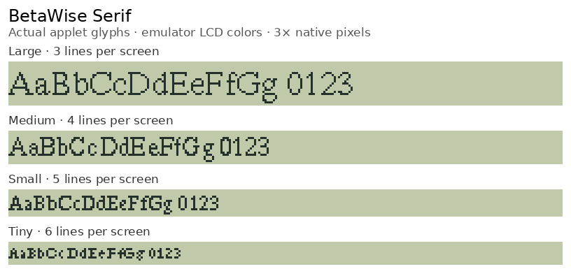
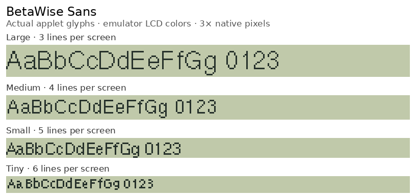
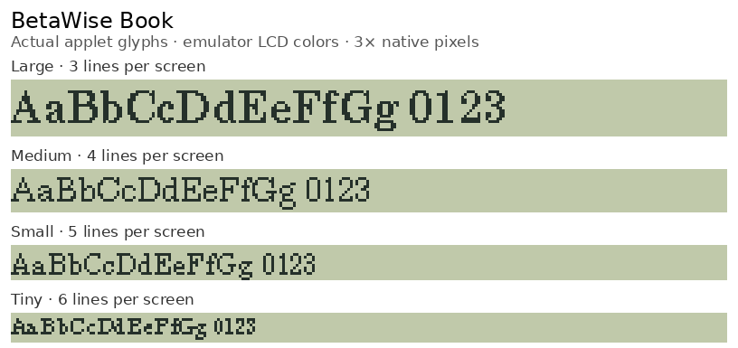
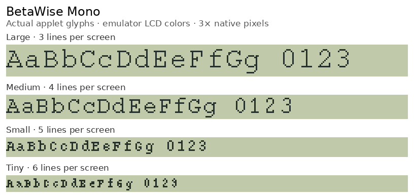
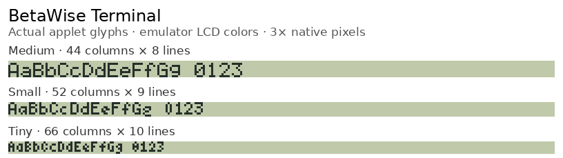

# BetaWise Fonts

Original X11 sources are pinned under `upstream/`. The build generates all
reader BDFs and Terminal Small/Tiny under `build/bdf/`; only Terminal Medium
remains a source BDF, in `BetaWiseTerminalMedium.bdf`. All providers use
[FontApplet.c](FontApplet.c).
Finished `.OS3KApp` files and intermediate files stay in
`build/<applet>/`, with headers named `glyphs.h`, `glyphs-bold.h`, etc.

Our original work in this folder is public domain. Third-party font notices
remain applicable; see [LICENSE.md](LICENSE.md).

## Font specimens

These samples use the actual glyph bytes in the built `.OS3KApp` files, enlarged
3× without smoothing, using the emulator LCD palette: background `#C0C9AA`
and ink `#25302A`. Each bitmap line is 264 native pixels wide; labels sit
outside the display area. Sizes therefore remain directly comparable. The
quick cards show Regular; the links show all four reader styles.

**BetaWise Serif** — [Regular, Bold, Italic and Bold Italic](specimens/serif-styles.png)



**BetaWise Sans** — [Regular, Bold, Italic and Bold Italic](specimens/sans-styles.png)



**BetaWise Book** — [Regular, Bold, Italic and Bold Italic](specimens/book-styles.png)



**BetaWise Mono** — [Regular, Bold, Italic and Bold Italic](specimens/mono-styles.png)



**BetaWise Terminal** — one style, three terminal resolutions



Regenerate the published documentation assets with
`python3 research/fonts/documentation_specimens.py` from the repository root.
The renderer verifies every linked glyph against its source BDF and keeps its
verification report under `research/fonts/build/documentation-specimens/`.
These PNGs are intentionally published documentation, unlike disposable
research reports and screenshots kept under `build/`.

## Provenance and changes

The four reader families come from X11 bitmap fonts at 75/100 dpi.
The applet INFO field carries the upstream copyright; the complete notices
remain in the BDFs and [license](LICENSE.md). Sizes below are source
pixel sizes, not the line pitch. BDFs are generated by the source recipe below;
letter bodies are native, including the six-line a/c/m forms.

| Family | Large / Medium / Small / Tiny | Six-line adaptation |
|---|---|---|
| BetaWise Serif | 17 / 12 / 11 / 8px | None |
| BetaWise Sans | 17 / 12 / 11 / 8px | Overflowing upper accents move down one row |
| BetaWise Book | 17 / 12 / 11 / 8px | Overflowing upper accents move down one row |
| BetaWise Mono | 20 / 14 / 11 / 8px | Upper accent moves; fixed cells; documented clipping; Regular m copied from Bold |

Mono has uniform 12 / 10 / 7 / 6px cells across all four styles. The extra
column is selected only when it reduces clipping. Three-line Bold euro clips
one rightmost column; oblique side overhangs are clipped separately.

BetaWise Terminal Medium’s 6×8 glyphs were independently recreated from the
AlphaSmart 3000 LCD controller font, including AlphaSmart’s custom modifications. Its 5×7 and 4×6 sources come from
public-domain X11 Misc Fixed. [LICENSE.md](LICENSE.md) distinguishes Terminal’s
provenance and notices from the reader fonts. The artifact includes this consolidated license file. BDFs use the shared Neo-US mapping. Medium remains exact against the independent
[PNG fixture](../tests/fonts/fixtures/); Small/Tiny preserve native Fixed artwork.

## Names and IDs

| Size | Lines | Serif | Sans | Book | Mono |
|---|---:|---|---|---|---|
| Tiny | 6 | AFF3 | AFF7 | AFFB | AFFF |
| Small | 5 | AFF2 | AFF6 | AFFA | AFFE |
| Medium | 4 | AFF1 | AFF5 | AFF9 | AFFD |
| Large | 3 | AFF0 | AFF4 | AFF8 | AFFC |

For example, `BetaWiseSerif-Tiny.OS3KApp` returns the font name
**BetaWise Serif Tiny**. Its applet name is automatically formed as
**BetaWise - Serif Tiny (6 lines)**. Each reader provider includes all four styles.

Terminal's Medium / Small / Tiny variants use 6×8 / 5×7 / 4×6 cells,
fitting 44×8 / 52×9 / 66×10 characters. All three retain ID A1F0; install one
at a time. Their font names are BetaWise Terminal Medium, BetaWise Terminal Small,
and BetaWise Terminal Tiny. Applet headers use `BetaWise - Terminal Medium (44x8)`,
`BetaWise - Terminal Small (52x9)` and `BetaWise - Terminal Tiny (66x10)`.
The native picker skips the eleven-byte `BetaWise - ` prefix.

## Build and conversion

Run `make -C fonts` from the repository root, or `make -C fonts readers` for
only the reader families. Select one with
`make -C fonts READER_FAMILY=Serif READER_LINES=6` or `make -C fonts FONT=Tiny`.
`make -C fonts clean` removes the entire `build/` tree and published font images.

The Makefile first runs the shared native-source recipe once, then invokes
[fontgen.py](fontgen.py) for each generated BDF. All four styles and the private
face are declared explicitly, including on a clean build. Its
`--symbol-prefix` option separates optional style symbols; `FontApplet.c` uses
`#ifdef` to include the available faces. Each header supplies one static const
descriptor in initialized RAM for CRT pointer relocation; glyph data stays in
flash. There is no per-query initialization or font-specific MSG_INIT handler.
Missing styles return NULL. Applet
names are derived from `FONT_NAME` and `FONT_LINES`, with a length check.
Generated headers belong only in `build/`; prototype readers use
`build/BetaWiseTerminal-Medium/glyphs.h` directly.

The converter also accepts PNG/PCF and gzip-compressed BDF/PCF. BDF encoding is
Neo-US byte slots 0–255; `os3k/charsets/neo-us.txt` supplies glyph identities.
PCF uses `--pcf-encoding` (default `iso8859-1`). Reader BDFs retain their original 218 printable Western slots and now include
available Neo-specific artwork from each original X11 strike. Glyphs that are
unavailable or exceed the existing cell remain absent; builds explicitly
substitute `?` for missing slots. Existing artwork and line metrics are preserved. The shared descriptor maps all 256 slots, including Ń and Σ. Slots 16/0D share
the return-arrow mapping; 90/60 share the grave-accent mapping.

Verification after building:

```
python3 -m unittest discover -s tests/fonts -p test_fontgen.py -v
python3 tests/fonts/check_minimal_fonts.py
```

Font providers use the common applet linker script and packaging rules. Their
C handler supplies Os3kEntry directly, so the SDK archive does not pull in CRT
or its default message pump. `__os3k_direct_entry` enables link-time checks
against GOT, initialized writable data and implicit BSS. Firmware supplies A5;
only the 16-byte descriptor for each face uses RAM (16 bytes per Terminal font,
80 per five-face reader font). The common image format includes a four-byte
unused relocation-table terminator.

Getters fill descriptors on demand, including before MSG_INIT. GCC's -mpcrel
forms runtime ROM addresses directly. The common linker places the regular
face before the handler and the remaining faces afterward to keep PC16
references in range, including packages larger than 32 KiB. Linker overflow
checks remain mandatory; font builds do not use GOT fallback.

The offline check executes all 19 shipping flat images on m68000 QEMU at two
independent ROM/RAM placements, starting with dirty RAM. It checks every packed
glyph byte against the BDF sources, descriptor/name/height messages, absent
faces, initialization, focus/unknown messages, and RAM guards. Binaries, raw
descriptor RAM, disassembly, relocations, hashes and results are preserved in
`tests/fonts/build/minimal/`. It uses no screenshots or model inference.

## Glyph review

`make -C research/fonts review` generates `research/fonts/build/glyph-review.html`.
`make -C research/fonts vector-review` generates `research/fonts/build/vector-review.html`.
Both use the generated BDFs and are ignored by Git; the generators, templates and
JavaScript live in [research](../research/fonts/review-tools.md).

## Reproducible native sources

The original X.Org BDF sources and their COPYING notices are pinned as Git
submodules under `upstream/75dpi`, `upstream/100dpi` and `upstream/misc`. Initialize
them with `git submodule update --init fonts/upstream/75dpi fonts/upstream/100dpi
fonts/upstream/misc` from the repository root. Applet builds require these source
submodules; generation is offline after initialization. Terminal Medium can also build independently from its source BDF
with `make -C fonts build/BetaWiseTerminal-Medium/BetaWiseTerminal-Medium.OS3KApp`.

See [the generation recipe](../research/fonts/README.md). Run
`make -C fonts bdfs` to generate intermediate BDFs, or `make -C fonts -j4`
to generate and build all providers. `make -C fonts clean` removes all generated
BDFs along with the headers, binaries and build reports.
The build report `fonts/build/bdf/generation-report.json` records source
strikes, missing Neo extras, accent translations and exact clipped pixels.
The earlier strict [policy preview](../research/font-policy/README.md) is historical.
[The archive](../research/font-archive/README.md) preserves the edited BDFs,
populated HTML/JavaScript tools and original inputs before regeneration.

Private small-cap/superscript BDFs for all 16 reader providers live under each
family's `private/` directory under `build/bdf/`. The applet includes one additional descriptor,
returned by `MSG_FONT_GET_PRIVATE` (`0x01000007`) through a `const FontHeader_t **`
output parameter. It uses [neo-smallcaps.json](../os3k/charsets/neo-smallcaps.json)
with Regular/Bold/Italic glyph ranges and superscript digits. Terminal returns
NULL. Standard getters and AFF0–AFFF IDs retain their existing meanings.
See [private-face generation](../research/fonts/smallcaps/README.md).

Superscript digits in the private faces are selected automatically from smaller
Regular strikes of the same family, targeting 60% of body capital height (the
accepted specimen middle column). They retain native artwork and advances and
align to the body H top. If the smallest set equals capital height, the 3×5
design is preferred when it is 1–2px smaller; digits taller than capitals also
use 3×5. Source choices are recorded in the generated BDF report. The current
3×5 exceptions are Sans Tiny, Book Tiny, Mono Small and Mono Tiny.

When the native and fallback designs are both 3×5, use the family-native digits.

The shared fallback artwork uses the TI-83/84 graph-screen small numerals:
three ink columns, five rows and four-pixel advances. The exact bitmaps and
published-source reference are in
[the shared digit descriptor](../research/fonts/superscript-3x5.json).
Selected same-family native digits remain unchanged.
